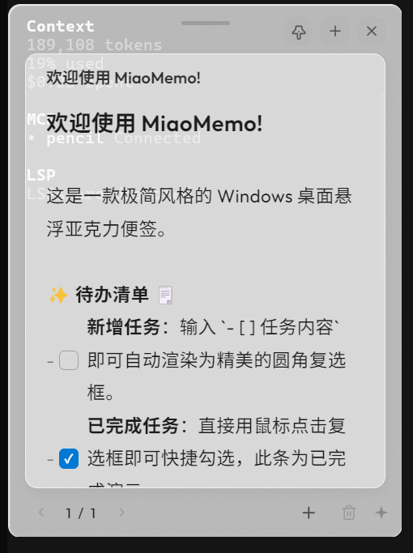

# MiaoMemo (喵喵便签)

<p align="center">
  
</p>

> A minimalist acrylic glassmorphism sticky notes app for Windows, built with Electron.

MiaoMemo 是一款专为 Windows 设计的极简风格桌面悬浮亚克力玻璃拟态便签。它采用了优雅的半透明亚克力材质（Acrylic Glassmorphism），支持多页翻页、Markdown 实时渲染以及可交互的精致圆角复选框清单。

**Key Features:** Acrylic glassmorphism design · 6 color themes · Markdown live preview · Interactive checklists · Multi-page notes · Always-on-top pinning · System tray integration · Auto-save with debounce.

---

## 🗒️ 功能特性

*   **极简亚克力美学**：精致的磨砂玻璃毛玻璃特效，完美贴合现代桌面审美。
*   **多主题切换**：支持 **经典白**、**暖阳黄**、**蜜桃粉**、**晴空蓝**、**薄荷绿**、**薰衣紫** 六种精美色彩，在便签区域内右键即可随时切换。
*   **智能双模交互**：
    *   **编辑模式**：点击文本框即可直接输入内容，支持 Markdown 语法。
    *   **预览模式**：失焦后自动进行排版渲染，标题、粗体均会美化。
*   **可交互复选框**：在预览模式下直接点击圆角复选框即可改变勾选状态（自动同步后台 Markdown 源码中的 `- [ ]` 和 `- [x]`），无需进入编辑状态。
*   **多页卡片（分页）**：每个便签卡片均支持新建下一页、删除当前页，在底部通过翻页按钮或直接点击页码弹出菜单进行跨页跳转。
*   **始终置顶 📌**：点击顶部左侧图钉高亮，锁定便签处于所有窗口最上层。
*   **快捷新建与系统托盘**：
    *   点击底部 `+` 即可迅速在桌面建立一个新便签（支持坐标级联错开，防止重叠）。
    *   双击系统托盘图标可快速创建便签，右键托盘支持显示所有或完全退出。
*   **安全数据自动保存**：写完即走，无需手动保存，数据在本地安全落地（采用防抖机制，避免频繁写入硬盘）。

---

---

## 🛠️ Project Structure / 项目结构

```bash
MiaoMemo/
├── main.js         # Main process: window lifecycle, IPC, tray management
├── preload.js      # Preload script: secure context bridge
├── renderer.js     # Renderer process: Markdown parsing, checklist, pagination
├── index.html      # UI structure: acrylic shell, modals, context menu
├── style.css       # Styles: CSS theming, acrylic noise texture, flexbox layout
├── fonts.css       # Local @font-face declarations for Outfit
├── fonts/          # Local font files (woff2)
├── build/          # Build assets (icon.ico)
├── package.json    # Project config, dependencies & electron-builder rules
└── screenshot.png  # App screenshot
```

---

---

## 🚀 Getting Started / 快速开始

### 运行环境
需要本地安装 [Node.js](https://nodejs.org/) 环境。

### 1. 安装依赖
在项目根目录下执行：
```bash
npm install
```

### 2. 启动开发模式
运行应用进行预览和调试：
```bash
npm start
```

### 3. 应用打包
打包生成 Windows x64 免安装版（Portable 独立单文件版，已自动配置好 256x256 高清 `.exe` 图标）：
```bash
npm run build
```
打包成功后，可在项目根目录下的 `dist/` 文件夹中找到生成的 `MiaoMemo 1.0.0.exe` 执行文件。

---

---

## ⌨️ Shortcuts / 快捷操作说明

*   **移动窗口**：按住顶部居中的胶囊拖拽条即可随意拖动窗口位置。
*   **右键菜单**：在便签任何区域单击右键可弹出菜单，支持**新建便签**和**更换主题**。
*   **删除便签**：点击顶部右侧的关闭（`×`）按钮，确认后将彻底删除该便签（关闭所有便签后应用自动安全退出）。
*   **删除单页**：点击底部垃圾桶图标，确认后仅删除当前页。

---

## License

MIT © [MiaoMemo](https://github.com/miaomemo/miaomemo)

